# preDrive database schema (B1.6)

## Verified development schema

- Supabase project: `preDrive` (`rjsdhgbjvghjnuiilizm`), region `eu-west-1`.
- PostgreSQL 17.12.
- 42 application tables in `public`; all 42 have RLS enabled. A static inventory of all 12 applied migration files matches the live catalog exactly for all 42 table names, 23 public enum names and five public view names; no missing or unexpected names were found in those three object classes.
- 37 tables currently have no RLS policies. This is deliberate deny-by-default staging before B2. All 42 tables have RLS enabled (none currently uses `FORCE ROW LEVEL SECURITY`). The `anon` role has no privileges on public application tables; `authenticated` has table-level SELECT only on `profiles`, `school_invitations`, `school_memberships`, `schools` and `staff_members`, with narrow column-level UPDATE grants on `profiles` (`full_name`, `language`, `phone`) and `schools` (`address`, `indicative_zig_per_usd`, `name`). The corresponding seven policies restrict those reads/updates. There are no authenticated table-level INSERT, UPDATE or DELETE grants and no client privileges on the other 37 tables.
- No application rows were inserted by B1.1–B1.6.
- All 51 foreign keys flagged as unindexed by Supabase Performance Advisor were given covering indexes in migration `20261121124613`. A follow-up advisor run no longer reports unindexed foreign keys. A static inventory finds 160 explicit `CREATE INDEX` declarations across the 13 repository migrations; every one exists in the live `public` catalog. The catalog contains 257 public indexes in total, with the remaining 97 created for primary-key/unique/constraint enforcement. The live catalog reports 384 public constraints.
- The 149 unused-index notices are expected in an empty development database and must be reassessed after representative workload tests; do not drop indexes merely to silence the advisor.
- Security Advisor still reports `pg_net` installed in `public`. A fresh read-only catalog audit on 2026-11-22 confirms `pg_net` 0.20.4 is owned by `supabase_admin`, has extension namespace `public`, is non-relocatable, and owns objects in the `net` schema. Do not propose `ALTER EXTENSION pg_net SET SCHEMA ...` or a relocation migration. The ACL expansion confirms `supabase_admin` is the grantor of `USAGE` on `net` to `PUBLIC` and the platform roles; `PUBLIC` has all privileges on `net.http_request_queue` and `net._http_response`, sequence privileges, and `EXECUTE` on the extension routines. Effective `EXECUTE` is true for `anon`, `authenticated` and `service_role`. This is a Supabase platform-owned ACL, not a grant created by the application migration role. Supabase's KB (updated 2026-11-04) explicitly states that per-project `GRANT`/`REVOKE` on these extension objects has no effect because `supabase_admin` owns the grants; dropping/recreating the extension reapplies them. Do not attempt ACL revokes, ownership changes, extension relocation, or drop/recreate as a workaround. Preserve pg_net because B4 may use it for scheduled Edge Function invocation; do not assume it is already used by application jobs. The current project has zero cron jobs and no application database webhook use was established in this audit. `anon` and `authenticated` are not LOGIN roles; the catalog lists only Supabase/platform login roles. Any direct database login role must be treated as trusted because pg_net queue rows include request URLs, headers and bodies, and the worker sends queued requests. Do not create direct-login roles for app users or expose database credentials to clients. Supabase documents that Data API reachability depends on whether `net` is in the exposed-schema allowlist; SQL privileges alone do not establish this. The current SQL catalog and repository `supabase/config.toml` do not establish the live allowlist. Verify in the project's Dashboard → Settings → API → Exposed schemas (and, if necessary, the Management API `GET /v1/projects/{ref}/postgrest`) that `net` and `private` are not exposed. If `net` is absent, retain the platform-owned grants as a documented exception; if it is exposed, stop and resolve the exposure before proceeding. Do not attempt to revoke pg_net grants from the connected `postgres` role.
- An on-time performance view is not defined yet: the schema does not yet establish an authoritative actual-arrival timestamp and lateness threshold. Do not fabricate an on-time metric. Resolve it against the API contract before adding it.

## Applied migrations

| Remote version | Migration |
|---|---|
| 20261120112956 | predrive_full_application_reset |
| 20261120181614 | core_identity_tenancy |
| 20261120181637 | tighten_profile_and_staff_visibility |
| 20261120181707 | lock_down_private_schema |
| 20261120181850 | index_membership_foreign_keys |
| 20261120181937 | revoke_all_public_default_privileges |
| 20261121124422 | predrive_children_guardians |
| 20261121124429 | predrive_transport_trips_gps |
| 20261121124437 | predrive_safety_operations |
| 20261121124444 | predrive_finance |
| 20261121124451 | predrive_settings_privacy_audit_analytics |
| 20261121124613 | predrive_foreign_key_indexes |

## Migration-chain exception

The remote migration ledger contains historical version `20261120112956` (`predrive_full_application_reset`). Its original SQL was recovered read-only from the remote `supabase_migrations.schema_migrations.statements` array and restored to `supabase/migrations/20261120112956_predrive_full_application_reset.sql`; a direct comparison now confirms the committed file is byte-for-byte identical to the ledger's `statements[0]` (2,281 bytes). All 12 remote versions have matching committed SQL files. A read-only comparison against each ledger `statements[0]` confirms normalized SQL text matches for all 12; six files are byte-exact and six differ only in comments/whitespace. An additional repository-only pgcrypto dependency migration is pending. The recovered migration is a destructive one-time reset: it unschedules every cron job, deletes all Vault secrets and Auth users, drops non-extension functions/relations/types in `public`, drops and recreates `private`, and deletes every row from `supabase_migrations.schema_migrations`. It must never be rerun against an existing environment containing data or secrets. The reset SQL assumes `cron.job`, `cron.unschedule(...)` and `vault.secrets` already exist before the application migrations begin. These schemas are present in the current development project, but their presence on a fresh hosted project is not yet verified. A preview branch cloned from the populated development project is not a clean replay target because it retains the parent's migration history and applies only new migrations. A clean-room replay is still **not yet certified**; it requires a separate, empty disposable hosted project.

## Static migration security review

- The live catalog contains 11 application routines, all in the `private` schema; there are no `public` application RPCs, and the generated public client types expose no RPC functions. The Supabase API exposed-schema configuration itself still requires dashboard verification. Seven are `SECURITY DEFINER`, and all 11 routines have an empty `search_path`. The migration history contains eight `SECURITY DEFINER` declarations; one historical helper (`private.can_view_profile`) was subsequently dropped/replaced. The two superseded policies (`profiles_select_self_or_school_colleague` and `staff_members_select_school_member`) are dropped by later migrations; the live seven-policy inventory matches the final policy declarations.
- A read-only privilege audit found no `anon` or `service_role` EXECUTE grants on these 11 routines. Only the two intended authenticated RLS helpers (`private.has_school_role` and `private.can_admin_view_profile`) are executable by `authenticated`. `authenticated` has `USAGE` on `private`; `anon` and `service_role` do not. Trigger helper functions remain callable through their installed triggers and are not granted as client RPCs.
- There are 36 enabled application triggers on `public` tables and one application-owned profile-sync trigger on `auth.users`. The public set comprises 26 explicit trigger declarations plus ten timestamp triggers created by two migration `DO` loops (six in B1.4 and four in B1.5). The other 11 observed `storage` triggers are Supabase-managed and are not application migrations. All 36 public triggers and the Auth profile-sync trigger are enabled.
- `service_role` has SELECT and INSERT on all 42 application tables, UPDATE and DELETE on 36; it is deliberately denied UPDATE/DELETE on `audit_log`, `consent_records`, `delay_reports`, `receipts`, `trip_events` and `vehicle_checks`. It remains a trusted server-only role and bypasses RLS; never expose its key to a client.
- Default-privilege audit: the repository migration revokes `anon`, `authenticated` and `service_role` defaults for objects created by `postgres` in `public`. Separate Supabase-managed default ACLs for `supabase_admin` still grant those roles broad privileges on future `public` tables, sequences and functions created by that owner. All 42 current application tables, five views and three sequences are owned by `postgres`, so those broad `supabase_admin` defaults do not grant access to the existing application objects. The connected `postgres` role is not a superuser and is not a member of `supabase_admin`, so it cannot change those defaults. Treat this as a platform-owner future-object concern, not a current application-table exposure. Do not attempt to alter platform-managed defaults from the current role. Determine whether Supabase has a supported configuration or document an accepted platform exception before sign-off.
- The reviewed function bodies schema-qualify application relations and private helper calls; this reduces object-shadowing risk. The review is static and does not replace executable privilege/RLS tests in B2.
- The reset migration is intentionally outside this security-function count; it contains anonymous `DO` blocks and destructive DDL.
- The current schema migrations do not create the B2 tenant authorization helper set or the B3 handover verification RPC. These remain planned work, not missing implementation claimed complete.

## Current Supabase advisor and generated-type observations

A fresh read-only advisor run on 2026-11-21 returned:

- Security: 37 `rls_enabled_no_policy` informational findings, matching the documented deny-by-default staging state; one warning for `pg_net` installed in `public`. The extension is non-relocatable in the current platform catalog; its owned objects are in `net`, while `pg_extension.extnamespace` is `public`.
- Performance: 149 `unused_index` informational findings. The development schema has not yet received representative application traffic, so these are not evidence that the indexes should be removed. Reassess after realistic workload and query-plan measurement.
- Health: no findings returned by the Health advisor.
- The previously reported unindexed-FK performance findings are absent after migration `20261121124613`.

A fresh TypeScript type-generation call against the current development project completed and returned the schema model, including the 42 tables, five views and 23 enums. It reports no exposed `public` RPC functions (`Functions: never`); private-schema functions are not part of the generated public client API. The latest generated output is an exact byte-for-byte match for committed `frontend/shared/types/database.types.ts` (93,685 bytes). The repository-only pgcrypto migration creates no public tables, columns, views or RPCs, so no generated type change is expected; final generation and typecheck must still be performed against the verified clean replay.

The Supabase branch inventory currently contains only the default `main` branch. No isolated verification branch has been created. Creating one is an explicit remote resource operation and remains outside the read-only work performed for this audit.

## Non-table and platform-object inventory

The following were checked against the connected development project using read-only catalog queries:

| Object area | Observed state | B1.6 treatment |
|---|---|---|
| Extensions | `pg_cron` 1.6.4 in `pg_catalog`; `pg_net` 0.20.4 has extension namespace `public` and is non-relocatable, while its owned objects are in `net`; `pg_stat_statements` 1.11, `pgcrypto` 1.3, `postgis` 3.3.7 and `uuid-ossp` 1.1 in `extensions`; `plpgsql` 1.0 in `pg_catalog`; `supabase_vault` 0.3.2 in `vault` | Preserve platform-managed extensions; verify each required extension and schema in the clean replay. Do not attempt to relocate `pg_net` with `ALTER EXTENSION ... SET SCHEMA`: its installed version reports `relocatable=false`. The Security Advisor warning remains open. The `net` schema grants `USAGE` and its HTTP functions inherit effective `EXECUTE` from PUBLIC, including for `anon` and `authenticated`; verify the Supabase API exposed-schema configuration and design least-privilege grants for trusted roles before sign-off. The reset migration's platform prerequisites (`cron.job`, `cron.unschedule(bigint)`, `vault.secrets`, and `supabase_migrations.schema_migrations`) were confirmed present in the current development project, and the connected `postgres` role has the required SELECT/EXECUTE/DELETE privileges. Their presence and privileges on a fresh hosted project remain unverified. Repository-only migration `20261121130000_predrive_enable_pgcrypto.sql` explicitly declares `CREATE EXTENSION IF NOT EXISTS pgcrypto WITH SCHEMA extensions`; it is not recorded as applied in the development migration ledger. The extension is already installed in the development database as `extensions.pgcrypto` 1.3. Verify the migration's idempotent behavior and extension placement on the clean hosted project. |
| Analytics views | Five public views; all five have `reloptions = {security_invoker=true}` | RLS-invoker behavior is verified on the current database. Do not report these views as default owner-security views. |
| Realtime publications | `supabase_realtime` exists with no application tables; the separate Supabase-managed `supabase_realtime_messages_publication` contains only `realtime.messages` | Keep the application publication empty until the explicit Realtime contract and required tables are approved; preserve the platform-managed messages publication. |
| pg_cron | Extension `pg_cron` 1.6.4 is installed in `pg_catalog`; zero scheduled jobs | Add jobs in B4 only after their functions and operational requirements are defined. |
| Storage | Zero application buckets and zero application Storage policies; Supabase-managed Storage triggers are present | Configure application buckets and policies in B2; preserve platform-managed Storage triggers and objects. |
| Auth integration | Supabase-managed `auth` schema; exactly one application-owned enabled trigger, `on_auth_user_profile_sync`, on `auth.users`, invoking `private.sync_auth_user_profile()` | Preserve managed Auth objects; verify only the application-owned trigger/function integration. |
| Application policies and grants | Seven policies across five tables; `anon` has no application-table privileges; `authenticated` has SELECT on five tables and narrow column-level UPDATE on profile/school fields; no client INSERT/DELETE | Current deny-by-default staging. Implement the approved role/tenant matrix in B2; review all future grants alongside policies. `postgres` default ACLs are restricted, but Supabase-managed `supabase_admin` defaults remain broad and cannot be altered by the connected migration role. |

The view security check used `pg_class.reloptions`; all five returned `security_invoker=true`. This supersedes any earlier preliminary concern that the analytics views might be running with owner privileges.

## Entity relationship diagram

Every application table and every database foreign-key relationship is represented below. Key columns are shown; the generated type definition contains all columns.

```mermaid
erDiagram
schools {
  id uuid PK
}
profiles {
  id uuid PK
}
school_memberships {
  id uuid PK
  school_id uuid FK
  user_id uuid
}
staff_members {
  id uuid PK
  school_id uuid FK
  user_id uuid
  role user_role
}
school_invitations {
  id uuid PK
  school_id uuid FK
  invited_by uuid
  accepted_by uuid
}
class_groups {
  id uuid PK
  school_id uuid FK
}
children {
  id uuid PK
  school_id uuid FK
  class_group_id uuid
}
guardian_children {
  id uuid PK
  school_id uuid FK
  guardian_user_id uuid
  child_id uuid
}
approved_collectors {
  id uuid PK
  school_id uuid FK
  child_id uuid
  created_by uuid
}
buses {
  id uuid PK
  school_id uuid FK
}
transport_routes {
  id uuid PK
  school_id uuid FK
  assigned_bus_id uuid
}
route_stops {
  id uuid PK
  school_id uuid FK
  route_id uuid
}
route_schedules {
  id uuid PK
  school_id uuid FK
  route_id uuid
}
trips {
  id uuid PK
  school_id uuid FK
  route_id uuid
  schedule_id uuid
  bus_id uuid
  supervisor_id uuid
  driver_id uuid
  started_by uuid
  ended_by uuid
}
trip_children {
  id uuid PK
  school_id uuid FK
  trip_id uuid
  child_id uuid
  recorded_by uuid
}
trip_events {
  id uuid PK
  school_id uuid FK
  trip_id uuid
  trip_child_id uuid
  actor_user_id uuid
}
bus_positions {
  trip_id uuid
  school_id uuid FK
  bus_id uuid
}
bus_position_history {
  id int8 PK
  school_id uuid FK
  trip_id uuid
  bus_id uuid
}
vehicle_checks {
  id uuid PK
  school_id uuid FK
  bus_id uuid
  trip_id uuid
  checked_by uuid
}
delay_reports {
  id uuid PK
  school_id uuid FK
  trip_id uuid
  reported_by uuid
}
incidents {
  id uuid PK
  school_id uuid FK
  trip_id uuid
  child_id uuid
  reported_by uuid
  resolved_by uuid
}
alerts {
  id uuid PK
  school_id uuid FK
  created_by uuid
  acknowledged_by uuid
  resolved_by uuid
}
alert_recipients {
  id uuid PK
  school_id uuid FK
  alert_id uuid
  recipient_user_id uuid
}
sos_events {
  id uuid PK
  school_id uuid FK
  raised_by uuid
  trip_id uuid
  alert_id uuid
  resolved_by uuid
}
broadcasts {
  id uuid PK
  school_id uuid FK
  created_by uuid
}
fee_items {
  id uuid PK
  school_id uuid FK
}
invoices {
  id uuid PK
  school_id uuid FK
  child_id uuid
  guardian_user_id uuid
  created_by uuid
}
invoice_lines {
  id uuid PK
  school_id uuid FK
  invoice_id uuid
  fee_item_id uuid
}
payments {
  id uuid PK
  school_id uuid FK
  invoice_id uuid
  created_by uuid
}
payment_attempts {
  id uuid PK
  school_id uuid FK
  payment_id uuid
}
bank_transfer_submissions {
  id uuid PK
  school_id uuid FK
  payment_id uuid
  reviewed_by uuid
}
refunds {
  id uuid PK
  school_id uuid FK
  payment_id uuid
  requested_by uuid
  reviewed_by uuid
}
credit_notes {
  id uuid PK
  school_id uuid FK
  invoice_id uuid
  issued_by uuid
}
receipts {
  id uuid PK
  school_id uuid FK
  payment_id uuid
}
settings {
  id uuid PK
  school_id uuid FK
  updated_by uuid
}
consent_records {
  id uuid PK
  school_id uuid FK
  subject_user_id uuid
  child_id uuid
  captured_by uuid
}
device_tokens {
  id uuid PK
  school_id uuid FK
  user_id uuid
}
deletion_requests {
  id uuid PK
  school_id uuid FK
  requested_by uuid
  subject_user_id uuid
  child_id uuid
  reviewed_by uuid
}
setup_progress {
  id uuid PK
  school_id uuid FK
  completed_by uuid
}
audit_log {
  id int8 PK
  school_id uuid FK
  actor_user_id uuid
}
rate_limit_events {
  id int8 PK
  school_id uuid FK
}
webhook_events {
  id uuid PK
  school_id uuid FK
}

  auth.users ||--o{ profiles : "profiles_id_fkey"
  profiles ||--o{ school_memberships : "school_memberships_user_id_fkey"
  schools ||--o{ school_memberships : "school_memberships_school_id_fkey"
  school_memberships ||--o{ staff_members : "staff_members_membership_fkey"
  profiles ||--o{ school_invitations : "school_invitations_invited_by_fkey"
  profiles ||--o{ school_invitations : "school_invitations_accepted_by_fkey"
  schools ||--o{ school_invitations : "school_invitations_school_id_fkey"
  schools ||--o{ class_groups : "class_groups_school_id_fkey"
  schools ||--o{ children : "children_school_id_fkey"
  class_groups ||--o{ children : "children_class_group_school_fkey"
  schools ||--o{ guardian_children : "guardian_children_school_id_fkey"
  children ||--o{ guardian_children : "guardian_children_child_school_fkey"
  school_memberships ||--o{ guardian_children : "guardian_children_guardian_membership_fkey"
  schools ||--o{ approved_collectors : "approved_collectors_school_id_fkey"
  profiles ||--o{ approved_collectors : "approved_collectors_created_by_fkey"
  children ||--o{ approved_collectors : "approved_collectors_child_school_fkey"
  schools ||--o{ buses : "buses_school_id_fkey"
  buses ||--o{ transport_routes : "transport_routes_assigned_bus_school_fkey"
  schools ||--o{ transport_routes : "transport_routes_school_id_fkey"
  schools ||--o{ route_stops : "route_stops_school_id_fkey"
  transport_routes ||--o{ route_stops : "route_stops_route_school_fkey"
  schools ||--o{ route_schedules : "route_schedules_school_id_fkey"
  transport_routes ||--o{ route_schedules : "route_schedules_route_school_fkey"
  schools ||--o{ trips : "trips_school_id_fkey"
  profiles ||--o{ trips : "trips_started_by_fkey"
  profiles ||--o{ trips : "trips_ended_by_fkey"
  transport_routes ||--o{ trips : "trips_route_school_fkey"
  route_schedules ||--o{ trips : "trips_schedule_school_fkey"
  buses ||--o{ trips : "trips_bus_school_fkey"
  staff_members ||--o{ trips : "trips_supervisor_school_fkey"
  staff_members ||--o{ trips : "trips_driver_school_fkey"
  children ||--o{ trip_children : "trip_children_child_school_fkey"
  schools ||--o{ trip_children : "trip_children_school_id_fkey"
  profiles ||--o{ trip_children : "trip_children_recorded_by_fkey"
  trips ||--o{ trip_children : "trip_children_trip_school_fkey"
  schools ||--o{ trip_events : "trip_events_school_id_fkey"
  trip_children ||--o{ trip_events : "trip_events_trip_child_school_trip_fkey"
  trips ||--o{ trip_events : "trip_events_trip_school_fkey"
  profiles ||--o{ trip_events : "trip_events_actor_user_id_fkey"
  schools ||--o{ bus_positions : "bus_positions_school_id_fkey"
  buses ||--o{ bus_positions : "bus_positions_bus_school_fkey"
  trips ||--o{ bus_positions : "bus_positions_trip_school_fkey"
  schools ||--o{ bus_position_history : "bus_position_history_school_id_fkey"
  buses ||--o{ bus_position_history : "bus_position_history_bus_school_fkey"
  trips ||--o{ bus_position_history : "bus_position_history_trip_school_fkey"
  trips ||--o{ vehicle_checks : "vehicle_checks_trip_school_fkey"
  buses ||--o{ vehicle_checks : "vehicle_checks_bus_school_fkey"
  profiles ||--o{ vehicle_checks : "vehicle_checks_checked_by_fkey"
  schools ||--o{ vehicle_checks : "vehicle_checks_school_id_fkey"
  profiles ||--o{ delay_reports : "delay_reports_reported_by_fkey"
  schools ||--o{ delay_reports : "delay_reports_school_id_fkey"
  trips ||--o{ delay_reports : "delay_reports_trip_school_fkey"
  profiles ||--o{ incidents : "incidents_reported_by_fkey"
  children ||--o{ incidents : "incidents_child_school_fkey"
  trips ||--o{ incidents : "incidents_trip_school_fkey"
  profiles ||--o{ incidents : "incidents_resolved_by_fkey"
  schools ||--o{ incidents : "incidents_school_id_fkey"
  profiles ||--o{ alerts : "alerts_acknowledged_by_fkey"
  schools ||--o{ alerts : "alerts_school_id_fkey"
  profiles ||--o{ alerts : "alerts_created_by_fkey"
  profiles ||--o{ alerts : "alerts_resolved_by_fkey"
  schools ||--o{ alert_recipients : "alert_recipients_school_id_fkey"
  alerts ||--o{ alert_recipients : "alert_recipients_alert_school_fkey"
  school_memberships ||--o{ alert_recipients : "alert_recipients_membership_fkey"
  profiles ||--o{ sos_events : "sos_events_raised_by_fkey"
  alerts ||--o{ sos_events : "sos_events_alert_school_fkey"
  schools ||--o{ sos_events : "sos_events_school_id_fkey"
  trips ||--o{ sos_events : "sos_events_trip_school_fkey"
  profiles ||--o{ sos_events : "sos_events_resolved_by_fkey"
  profiles ||--o{ broadcasts : "broadcasts_created_by_fkey"
  schools ||--o{ broadcasts : "broadcasts_school_id_fkey"
  schools ||--o{ fee_items : "fee_items_school_id_fkey"
  children ||--o{ invoices : "invoices_child_school_fkey"
  schools ||--o{ invoices : "invoices_school_id_fkey"
  school_memberships ||--o{ invoices : "invoices_guardian_membership_fkey"
  profiles ||--o{ invoices : "invoices_created_by_fkey"
  fee_items ||--o{ invoice_lines : "invoice_lines_fee_item_school_fkey"
  invoices ||--o{ invoice_lines : "invoice_lines_invoice_school_fkey"
  schools ||--o{ invoice_lines : "invoice_lines_school_id_fkey"
  invoices ||--o{ payments : "payments_invoice_school_fkey"
  profiles ||--o{ payments : "payments_created_by_fkey"
  schools ||--o{ payments : "payments_school_id_fkey"
  schools ||--o{ payment_attempts : "payment_attempts_school_id_fkey"
  payments ||--o{ payment_attempts : "payment_attempts_payment_school_fkey"
  payments ||--o{ bank_transfer_submissions : "bank_transfer_submissions_payment_school_fkey"
  profiles ||--o{ bank_transfer_submissions : "bank_transfer_submissions_reviewed_by_fkey"
  schools ||--o{ bank_transfer_submissions : "bank_transfer_submissions_school_id_fkey"
  profiles ||--o{ refunds : "refunds_reviewed_by_fkey"
  profiles ||--o{ refunds : "refunds_requested_by_fkey"
  schools ||--o{ refunds : "refunds_school_id_fkey"
  payments ||--o{ refunds : "refunds_payment_school_fkey"
  schools ||--o{ credit_notes : "credit_notes_school_id_fkey"
  invoices ||--o{ credit_notes : "credit_notes_invoice_school_fkey"
  profiles ||--o{ credit_notes : "credit_notes_issued_by_fkey"
  schools ||--o{ receipts : "receipts_school_id_fkey"
  payments ||--o{ receipts : "receipts_payment_school_fkey"
  profiles ||--o{ settings : "settings_updated_by_fkey"
  schools ||--o{ settings : "settings_school_id_fkey"
  children ||--o{ consent_records : "consent_records_child_school_fkey"
  profiles ||--o{ consent_records : "consent_records_subject_user_id_fkey"
  schools ||--o{ consent_records : "consent_records_school_id_fkey"
  profiles ||--o{ consent_records : "consent_records_captured_by_fkey"
  schools ||--o{ device_tokens : "device_tokens_school_id_fkey"
  school_memberships ||--o{ device_tokens : "device_tokens_membership_fkey"
  children ||--o{ deletion_requests : "deletion_requests_child_school_fkey"
  profiles ||--o{ deletion_requests : "deletion_requests_subject_user_id_fkey"
  profiles ||--o{ deletion_requests : "deletion_requests_reviewed_by_fkey"
  profiles ||--o{ deletion_requests : "deletion_requests_requested_by_fkey"
  schools ||--o{ deletion_requests : "deletion_requests_school_id_fkey"
  profiles ||--o{ setup_progress : "setup_progress_completed_by_fkey"
  schools ||--o{ setup_progress : "setup_progress_school_id_fkey"
  profiles ||--o{ audit_log : "audit_log_actor_user_id_fkey"
  schools ||--o{ audit_log : "audit_log_school_id_fkey"
  schools ||--o{ rate_limit_events : "rate_limit_events_school_id_fkey"
  schools ||--o{ webhook_events : "webhook_events_school_id_fkey"
```

## Generated types

Generated directly from the connected development database. Source: `frontend/shared/types/database.types.ts`. Regenerate and commit the diff after every schema migration.

## Frontend API contract checkpoint

The exact frontend-facing contract is documented in [API-CONTRACT.md](./API-CONTRACT.md). The current `PreDriveApi` contains 30 operations across auth, school, children, staff, transport, safety and finance. This corrects an earlier planning note that counted 29. The contract currently defines no Realtime subscription methods or event payloads; no Realtime publication tables should be enabled until that contract is explicitly extended.
## B1.6 read-only verification refresh — 2026-11-21

The existing development project was rechecked without making database changes. Catalog counts reconfirmed 42 public application tables with RLS enabled, 37 without policies, seven public policies, five public views with `security_invoker=true`, and 12 migration-ledger entries. The required installed extensions (`pgcrypto`, `postgis`, `pg_cron`, `pg_net`, `supabase_vault`) are present.

Type generation was repeated from the live project. The generated output is exactly 93,685 characters and matches `frontend/shared/types/database.types.ts` byte-for-byte.

Latest advisors: Security reports 37 informational `rls_enabled_no_policy` findings and one `extension_in_public` warning for `pg_net`; Performance reports 149 informational `unused_index` findings; Health reports no findings. The RLS notices reflect the deliberate deny-by-default state before B2. The unused-index notices are not grounds for dropping indexes in a database without representative workload. The `pg_net` warning remains unresolved; it is non-relocatable in this project and must not be moved with `ALTER EXTENSION ... SET SCHEMA`.

This is a refresh of the current-development inventory, not a clean-room replay. PostgREST exposed-schema configuration cannot be read from the SQL catalog; verify in Supabase Dashboard → Settings → API → Exposed schemas that `private` and `net` are not exposed. The empty-database migration replay and the `supabase_admin` default-ACL platform exception remain outstanding.