# preDrive database schema (B1.6)

## Verified development schema

- Supabase project: `preDrive` (`rjsdhgbjvghjnuiilizm`), region `eu-west-1`.
- PostgreSQL 17.12.
- 42 application tables in `public`; all 42 have RLS enabled.
- 37 tables currently have no RLS policies. This is deliberate deny-by-default staging before B2; client table privileges remain withheld until role policies are implemented.
- No application rows were inserted by B1.1–B1.6.
- All 51 foreign keys flagged as unindexed by Supabase Performance Advisor were given covering indexes in migration `20261121124613`. A follow-up advisor run no longer reports unindexed foreign keys.
- The 149 unused-index notices are expected in an empty development database and must be reassessed after representative workload tests; do not drop indexes merely to silence the advisor.
- Security Advisor still reports the pre-existing `pg_net` extension in `public`; relocate it to a non-exposed schema in a dedicated configuration migration after verifying extension support.
- An on-time performance view is not defined yet: the schema does not yet establish an authoritative actual-arrival timestamp and lateness threshold. Do not fabricate an on-time metric. Resolve it against the API contract before adding it.

## Applied migrations

| Remote version | Migration |
|---|---|
| 20261120112956 | predrive_full_application_reset |
| 20261120181614 | core_identity_tenancy |
| 20261120181637 | tighten_profile_and_staff_visibility |
| 20261120181707 | lock_down_private_schema |
| 20261120181850 | index_membership_foreign_keys |
| 20261120181937 | revoke_all_public_default_privileges |
| 20261121124422 | predrive_children_guardians |
| 20261121124429 | predrive_transport_trips_gps |
| 20261121124437 | predrive_safety_operations |
| 20261121124444 | predrive_finance |
| 20261121124451 | predrive_settings_privacy_audit_analytics |
| 20261121124613 | predrive_foreign_key_indexes |

## Migration-chain exception

The remote migration ledger contains historical version `20261120112956` (`predrive_full_application_reset`). Its original SQL was recovered read-only from the remote `supabase_migrations.schema_migrations.statements` array and restored to `supabase/migrations/20261120112956_predrive_full_application_reset.sql`. All 12 remote versions now have matching committed SQL files. The recovered migration is a destructive one-time reset: it unschedules cron jobs, deletes Vault secrets and Auth users, drops non-extension objects in `private` and `public`, and clears the migration ledger. It must never be rerun against an existing environment containing data or secrets. A clean-room replay is still **not yet certified**; validate the restored chain only on a genuinely fresh isolated hosted branch.

## Non-table and platform-object inventory

The following were checked against the connected development project using read-only catalog queries:

| Object area | Observed state | B1.6 treatment |
|---|---|---|
| Extensions | `pg_cron` 1.6.4 in `pg_catalog`; `pg_net` 0.20.4 in `public`; `pg_stat_statements` 1.11, `pgcrypto` 1.3, `postgis` 3.3.7 and `uuid-ossp` 1.1 in `extensions`; `plpgsql` 1.0 in `pg_catalog`; `supabase_vault` 0.3.2 in `vault` | Preserve platform-managed extensions; verify each required extension and schema in the clean replay. `pg_net` in exposed `public` remains a Security Advisor finding to assess separately. |
| Analytics views | Five public views; all five have `reloptions = {security_invoker=true}` | RLS-invoker behavior is verified on the current database. Do not report these views as default owner-security views. |
| Realtime publication | `supabase_realtime` exists with no application tables currently published | Keep empty until the explicit Realtime contract and required tables are approved. |
| pg_cron | Extension installed; zero scheduled jobs | Add jobs in B4 only after their functions and operational requirements are defined. |
| Storage | Zero application buckets and zero application Storage policies | Configure buckets and policies in B2. |
| Auth integration | Supabase-managed `auth` schema and an application-owned profile-sync trigger on `auth.users` | Preserve managed Auth objects; verify only the application-owned trigger/function integration. |
| Application policies | Seven policies across five tables; 37 RLS-enabled tables have no policies | Current deny-by-default staging. Implement the approved role/tenant matrix in B2. |

The view security check used `pg_class.reloptions`; all five returned `security_invoker=true`. This supersedes any earlier preliminary concern that the analytics views might be running with owner privileges.

## Entity relationship diagram

Every application table and every database foreign-key relationship is represented below. Key columns are shown; the generated type definition contains all columns.

```mermaid
erDiagram
schools {
  id uuid PK
}
profiles {
  id uuid PK
}
school_memberships {
  id uuid PK
  school_id uuid FK
  user_id uuid
}
staff_members {
  id uuid PK
  school_id uuid FK
  user_id uuid
  role user_role
}
school_invitations {
  id uuid PK
  school_id uuid FK
  invited_by uuid
  accepted_by uuid
}
class_groups {
  id uuid PK
  school_id uuid FK
}
children {
  id uuid PK
  school_id uuid FK
  class_group_id uuid
}
guardian_children {
  id uuid PK
  school_id uuid FK
  guardian_user_id uuid
  child_id uuid
}
approved_collectors {
  id uuid PK
  school_id uuid FK
  child_id uuid
  created_by uuid
}
buses {
  id uuid PK
  school_id uuid FK
}
transport_routes {
  id uuid PK
  school_id uuid FK
  assigned_bus_id uuid
}
route_stops {
  id uuid PK
  school_id uuid FK
  route_id uuid
}
route_schedules {
  id uuid PK
  school_id uuid FK
  route_id uuid
}
trips {
  id uuid PK
  school_id uuid FK
  route_id uuid
  schedule_id uuid
  bus_id uuid
  supervisor_id uuid
  driver_id uuid
  started_by uuid
  ended_by uuid
}
trip_children {
  id uuid PK
  school_id uuid FK
  trip_id uuid
  child_id uuid
  recorded_by uuid
}
trip_events {
  id uuid PK
  school_id uuid FK
  trip_id uuid
  trip_child_id uuid
  actor_user_id uuid
}
bus_positions {
  trip_id uuid
  school_id uuid FK
  bus_id uuid
}
bus_position_history {
  id int8 PK
  school_id uuid FK
  trip_id uuid
  bus_id uuid
}
vehicle_checks {
  id uuid PK
  school_id uuid FK
  bus_id uuid
  trip_id uuid
  checked_by uuid
}
delay_reports {
  id uuid PK
  school_id uuid FK
  trip_id uuid
  reported_by uuid
}
incidents {
  id uuid PK
  school_id uuid FK
  trip_id uuid
  child_id uuid
  reported_by uuid
  resolved_by uuid
}
alerts {
  id uuid PK
  school_id uuid FK
  created_by uuid
  acknowledged_by uuid
  resolved_by uuid
}
alert_recipients {
  id uuid PK
  school_id uuid FK
  alert_id uuid
  recipient_user_id uuid
}
sos_events {
  id uuid PK
  school_id uuid FK
  raised_by uuid
  trip_id uuid
  alert_id uuid
  resolved_by uuid
}
broadcasts {
  id uuid PK
  school_id uuid FK
  created_by uuid
}
fee_items {
  id uuid PK
  school_id uuid FK
}
invoices {
  id uuid PK
  school_id uuid FK
  child_id uuid
  guardian_user_id uuid
  created_by uuid
}
invoice_lines {
  id uuid PK
  school_id uuid FK
  invoice_id uuid
  fee_item_id uuid
}
payments {
  id uuid PK
  school_id uuid FK
  invoice_id uuid
  created_by uuid
}
payment_attempts {
  id uuid PK
  school_id uuid FK
  payment_id uuid
}
bank_transfer_submissions {
  id uuid PK
  school_id uuid FK
  payment_id uuid
  reviewed_by uuid
}
refunds {
  id uuid PK
  school_id uuid FK
  payment_id uuid
  requested_by uuid
  reviewed_by uuid
}
credit_notes {
  id uuid PK
  school_id uuid FK
  invoice_id uuid
  issued_by uuid
}
receipts {
  id uuid PK
  school_id uuid FK
  payment_id uuid
}
settings {
  id uuid PK
  school_id uuid FK
  updated_by uuid
}
consent_records {
  id uuid PK
  school_id uuid FK
  subject_user_id uuid
  child_id uuid
  captured_by uuid
}
device_tokens {
  id uuid PK
  school_id uuid FK
  user_id uuid
}
deletion_requests {
  id uuid PK
  school_id uuid FK
  requested_by uuid
  subject_user_id uuid
  child_id uuid
  reviewed_by uuid
}
setup_progress {
  id uuid PK
  school_id uuid FK
  completed_by uuid
}
audit_log {
  id int8 PK
  school_id uuid FK
  actor_user_id uuid
}
rate_limit_events {
  id int8 PK
  school_id uuid FK
}
webhook_events {
  id uuid PK
  school_id uuid FK
}

  auth.users ||--o{ profiles : "profiles_id_fkey"
  profiles ||--o{ school_memberships : "school_memberships_user_id_fkey"
  schools ||--o{ school_memberships : "school_memberships_school_id_fkey"
  school_memberships ||--o{ staff_members : "staff_members_membership_fkey"
  profiles ||--o{ school_invitations : "school_invitations_invited_by_fkey"
  profiles ||--o{ school_invitations : "school_invitations_accepted_by_fkey"
  schools ||--o{ school_invitations : "school_invitations_school_id_fkey"
  schools ||--o{ class_groups : "class_groups_school_id_fkey"
  schools ||--o{ children : "children_school_id_fkey"
  class_groups ||--o{ children : "children_class_group_school_fkey"
  schools ||--o{ guardian_children : "guardian_children_school_id_fkey"
  children ||--o{ guardian_children : "guardian_children_child_school_fkey"
  school_memberships ||--o{ guardian_children : "guardian_children_guardian_membership_fkey"
  schools ||--o{ approved_collectors : "approved_collectors_school_id_fkey"
  profiles ||--o{ approved_collectors : "approved_collectors_created_by_fkey"
  children ||--o{ approved_collectors : "approved_collectors_child_school_fkey"
  schools ||--o{ buses : "buses_school_id_fkey"
  buses ||--o{ transport_routes : "transport_routes_assigned_bus_school_fkey"
  schools ||--o{ transport_routes : "transport_routes_school_id_fkey"
  schools ||--o{ route_stops : "route_stops_school_id_fkey"
  transport_routes ||--o{ route_stops : "route_stops_route_school_fkey"
  schools ||--o{ route_schedules : "route_schedules_school_id_fkey"
  transport_routes ||--o{ route_schedules : "route_schedules_route_school_fkey"
  schools ||--o{ trips : "trips_school_id_fkey"
  profiles ||--o{ trips : "trips_started_by_fkey"
  profiles ||--o{ trips : "trips_ended_by_fkey"
  transport_routes ||--o{ trips : "trips_route_school_fkey"
  route_schedules ||--o{ trips : "trips_schedule_school_fkey"
  buses ||--o{ trips : "trips_bus_school_fkey"
  staff_members ||--o{ trips : "trips_supervisor_school_fkey"
  staff_members ||--o{ trips : "trips_driver_school_fkey"
  children ||--o{ trip_children : "trip_children_child_school_fkey"
  schools ||--o{ trip_children : "trip_children_school_id_fkey"
  profiles ||--o{ trip_children : "trip_children_recorded_by_fkey"
  trips ||--o{ trip_children : "trip_children_trip_school_fkey"
  schools ||--o{ trip_events : "trip_events_school_id_fkey"
  trip_children ||--o{ trip_events : "trip_events_trip_child_school_trip_fkey"
  trips ||--o{ trip_events : "trip_events_trip_school_fkey"
  profiles ||--o{ trip_events : "trip_events_actor_user_id_fkey"
  schools ||--o{ bus_positions : "bus_positions_school_id_fkey"
  buses ||--o{ bus_positions : "bus_positions_bus_school_fkey"
  trips ||--o{ bus_positions : "bus_positions_trip_school_fkey"
  schools ||--o{ bus_position_history : "bus_position_history_school_id_fkey"
  buses ||--o{ bus_position_history : "bus_position_history_bus_school_fkey"
  trips ||--o{ bus_position_history : "bus_position_history_trip_school_fkey"
  trips ||--o{ vehicle_checks : "vehicle_checks_trip_school_fkey"
  buses ||--o{ vehicle_checks : "vehicle_checks_bus_school_fkey"
  profiles ||--o{ vehicle_checks : "vehicle_checks_checked_by_fkey"
  schools ||--o{ vehicle_checks : "vehicle_checks_school_id_fkey"
  profiles ||--o{ delay_reports : "delay_reports_reported_by_fkey"
  schools ||--o{ delay_reports : "delay_reports_school_id_fkey"
  trips ||--o{ delay_reports : "delay_reports_trip_school_fkey"
  profiles ||--o{ incidents : "incidents_reported_by_fkey"
  children ||--o{ incidents : "incidents_child_school_fkey"
  trips ||--o{ incidents : "incidents_trip_school_fkey"
  profiles ||--o{ incidents : "incidents_resolved_by_fkey"
  schools ||--o{ incidents : "incidents_school_id_fkey"
  profiles ||--o{ alerts : "alerts_acknowledged_by_fkey"
  schools ||--o{ alerts : "alerts_school_id_fkey"
  profiles ||--o{ alerts : "alerts_created_by_fkey"
  profiles ||--o{ alerts : "alerts_resolved_by_fkey"
  schools ||--o{ alert_recipients : "alert_recipients_school_id_fkey"
  alerts ||--o{ alert_recipients : "alert_recipients_alert_school_fkey"
  school_memberships ||--o{ alert_recipients : "alert_recipients_membership_fkey"
  profiles ||--o{ sos_events : "sos_events_raised_by_fkey"
  alerts ||--o{ sos_events : "sos_events_alert_school_fkey"
  schools ||--o{ sos_events : "sos_events_school_id_fkey"
  trips ||--o{ sos_events : "sos_events_trip_school_fkey"
  profiles ||--o{ sos_events : "sos_events_resolved_by_fkey"
  profiles ||--o{ broadcasts : "broadcasts_created_by_fkey"
  schools ||--o{ broadcasts : "broadcasts_school_id_fkey"
  schools ||--o{ fee_items : "fee_items_school_id_fkey"
  children ||--o{ invoices : "invoices_child_school_fkey"
  schools ||--o{ invoices : "invoices_school_id_fkey"
  school_memberships ||--o{ invoices : "invoices_guardian_membership_fkey"
  profiles ||--o{ invoices : "invoices_created_by_fkey"
  fee_items ||--o{ invoice_lines : "invoice_lines_fee_item_school_fkey"
  invoices ||--o{ invoice_lines : "invoice_lines_invoice_school_fkey"
  schools ||--o{ invoice_lines : "invoice_lines_school_id_fkey"
  invoices ||--o{ payments : "payments_invoice_school_fkey"
  profiles ||--o{ payments : "payments_created_by_fkey"
  schools ||--o{ payments : "payments_school_id_fkey"
  schools ||--o{ payment_attempts : "payment_attempts_school_id_fkey"
  payments ||--o{ payment_attempts : "payment_attempts_payment_school_fkey"
  payments ||--o{ bank_transfer_submissions : "bank_transfer_submissions_payment_school_fkey"
  profiles ||--o{ bank_transfer_submissions : "bank_transfer_submissions_reviewed_by_fkey"
  schools ||--o{ bank_transfer_submissions : "bank_transfer_submissions_school_id_fkey"
  profiles ||--o{ refunds : "refunds_reviewed_by_fkey"
  profiles ||--o{ refunds : "refunds_requested_by_fkey"
  schools ||--o{ refunds : "refunds_school_id_fkey"
  payments ||--o{ refunds : "refunds_payment_school_fkey"
  schools ||--o{ credit_notes : "credit_notes_school_id_fkey"
  invoices ||--o{ credit_notes : "credit_notes_invoice_school_fkey"
  profiles ||--o{ credit_notes : "credit_notes_issued_by_fkey"
  schools ||--o{ receipts : "receipts_school_id_fkey"
  payments ||--o{ receipts : "receipts_payment_school_fkey"
  profiles ||--o{ settings : "settings_updated_by_fkey"
  schools ||--o{ settings : "settings_school_id_fkey"
  children ||--o{ consent_records : "consent_records_child_school_fkey"
  profiles ||--o{ consent_records : "consent_records_subject_user_id_fkey"
  schools ||--o{ consent_records : "consent_records_school_id_fkey"
  profiles ||--o{ consent_records : "consent_records_captured_by_fkey"
  schools ||--o{ device_tokens : "device_tokens_school_id_fkey"
  school_memberships ||--o{ device_tokens : "device_tokens_membership_fkey"
  children ||--o{ deletion_requests : "deletion_requests_child_school_fkey"
  profiles ||--o{ deletion_requests : "deletion_requests_subject_user_id_fkey"
  profiles ||--o{ deletion_requests : "deletion_requests_reviewed_by_fkey"
  profiles ||--o{ deletion_requests : "deletion_requests_requested_by_fkey"
  schools ||--o{ deletion_requests : "deletion_requests_school_id_fkey"
  profiles ||--o{ setup_progress : "setup_progress_completed_by_fkey"
  schools ||--o{ setup_progress : "setup_progress_school_id_fkey"
  profiles ||--o{ audit_log : "audit_log_actor_user_id_fkey"
  schools ||--o{ audit_log : "audit_log_school_id_fkey"
  schools ||--o{ rate_limit_events : "rate_limit_events_school_id_fkey"
  schools ||--o{ webhook_events : "webhook_events_school_id_fkey"
```

## Generated types

Generated directly from the connected development database. Source: `frontend/shared/types/database.types.ts`. Regenerate and commit the diff after every schema migration.
