# preDrive database schema reference

This document describes the intended application schema. The current connected-development inventory, migration status and outstanding drift checks are recorded in [BACKEND-SCHEMA.md](./BACKEND-SCHEMA.md). The migration lifecycle and online verification process are documented in [MIGRATIONS.md](./MIGRATIONS.md). The SQL files in `supabase/migrations/` remain authoritative; this ERD is a navigation aid, not a substitute for the DDL.

## Tenant model

- `schools` is the tenant root; its primary key is the tenant identifier.
- `profiles` are global Supabase Auth identities and intentionally do not have `school_id`.
- All other school-owned tables have `school_id` and enable Row Level Security.
- Cross-tenant relationships are constrained by school-scoped foreign keys where required.
- The indicative USD/ZiG rate belongs in `settings` as `indicative_zig_per_usd`. The existing `schools.indicative_zig_per_usd` column is retained temporarily for compatibility with the already-applied identity foundation; adapter work must use the settings record as the authoritative value and a later migration should retire the legacy column only after all consumers are migrated.

## Entity relationship diagram

The diagram lists all 42 tables created by the application migrations. Each edge represents a foreign-key relationship; the exact composite key columns, delete actions, indexes, checks and unique constraints remain defined by the SQL migrations.

```mermaid
erDiagram
  schools {
    uuid id PK
  }
  profiles {
    uuid id PK
  }
  school_memberships {
    uuid id PK
    uuid school_id FK
  }
  staff_members {
    uuid id PK
    uuid school_id FK
  }
  school_invitations {
    uuid id PK
    uuid school_id FK
  }
  class_groups {
    uuid id PK
    uuid school_id FK
  }
  children {
    uuid id PK
    uuid school_id FK
  }
  guardian_children {
    uuid id PK
    uuid school_id FK
  }
  approved_collectors {
    uuid id PK
    uuid school_id FK
  }
  buses {
    uuid id PK
    uuid school_id FK
  }
  transport_routes {
    uuid id PK
    uuid school_id FK
  }
  route_stops {
    uuid id PK
    uuid school_id FK
  }
  route_schedules {
    uuid id PK
    uuid school_id FK
  }
  trips {
    uuid id PK
    uuid school_id FK
  }
  trip_children {
    uuid id PK
    uuid school_id FK
  }
  trip_events {
    uuid id PK
    uuid school_id FK
  }
  bus_positions {
    uuid trip_id PK, FK
    uuid school_id FK
  }
  bus_position_history {
    bigint id PK
    uuid school_id FK
  }
  vehicle_checks {
    uuid id PK
    uuid school_id FK
  }
  delay_reports {
    uuid id PK
    uuid school_id FK
  }
  incidents {
    uuid id PK
    uuid school_id FK
  }
  alerts {
    uuid id PK
    uuid school_id FK
  }
  alert_recipients {
    uuid id PK
    uuid school_id FK
  }
  sos_events {
    uuid id PK
    uuid school_id FK
  }
  broadcasts {
    uuid id PK
    uuid school_id FK
  }
  fee_items {
    uuid id PK
    uuid school_id FK
  }
  invoices {
    uuid id PK
    uuid school_id FK
  }
  invoice_lines {
    uuid id PK
    uuid school_id FK
  }
  payments {
    uuid id PK
    uuid school_id FK
  }
  payment_attempts {
    uuid id PK
    uuid school_id FK
  }
  bank_transfer_submissions {
    uuid id PK
    uuid school_id FK
  }
  refunds {
    uuid id PK
    uuid school_id FK
  }
  credit_notes {
    uuid id PK
    uuid school_id FK
  }
  receipts {
    uuid id PK
    uuid school_id FK
  }
  settings {
    uuid id PK
    uuid school_id FK
  }
  consent_records {
    uuid id PK
    uuid school_id FK
  }
  device_tokens {
    uuid id PK
    uuid school_id FK
  }
  deletion_requests {
    uuid id PK
    uuid school_id FK
  }
  setup_progress {
    uuid id PK
    uuid school_id FK
  }
  audit_log {
    bigint id PK
    uuid school_id FK
  }
  rate_limit_events {
    bigint id PK
    uuid school_id FK
  }
  webhook_events {
    uuid id PK
    uuid school_id FK
  }
schools ||--o{ school_memberships : "foreign key"
profiles ||--o{ school_memberships : "foreign key"
school_memberships ||--o{ staff_members : "foreign key"
schools ||--o{ school_invitations : "foreign key"
profiles ||--o{ school_invitations : "foreign key"
schools ||--o{ class_groups : "foreign key"
schools ||--o{ children : "foreign key"
class_groups ||--o{ children : "foreign key"
schools ||--o{ guardian_children : "foreign key"
school_memberships ||--o{ guardian_children : "foreign key"
children ||--o{ guardian_children : "foreign key"
schools ||--o{ approved_collectors : "foreign key"
profiles ||--o{ approved_collectors : "foreign key"
children ||--o{ approved_collectors : "foreign key"
schools ||--o{ buses : "foreign key"
schools ||--o{ transport_routes : "foreign key"
buses ||--o{ transport_routes : "foreign key"
schools ||--o{ route_stops : "foreign key"
transport_routes ||--o{ route_stops : "foreign key"
schools ||--o{ route_schedules : "foreign key"
transport_routes ||--o{ route_schedules : "foreign key"
schools ||--o{ trips : "foreign key"
profiles ||--o{ trips : "foreign key"
transport_routes ||--o{ trips : "foreign key"
route_schedules ||--o{ trips : "foreign key"
buses ||--o{ trips : "foreign key"
staff_members ||--o{ trips : "foreign key"
schools ||--o{ trip_children : "foreign key"
profiles ||--o{ trip_children : "foreign key"
trips ||--o{ trip_children : "foreign key"
children ||--o{ trip_children : "foreign key"
schools ||--o{ trip_events : "foreign key"
profiles ||--o{ trip_events : "foreign key"
trips ||--o{ trip_events : "foreign key"
trip_children ||--o{ trip_events : "foreign key"
schools ||--o{ bus_positions : "foreign key"
trips ||--o{ bus_positions : "foreign key"
buses ||--o{ bus_positions : "foreign key"
schools ||--o{ bus_position_history : "foreign key"
trips ||--o{ bus_position_history : "foreign key"
buses ||--o{ bus_position_history : "foreign key"
schools ||--o{ vehicle_checks : "foreign key"
profiles ||--o{ vehicle_checks : "foreign key"
buses ||--o{ vehicle_checks : "foreign key"
trips ||--o{ vehicle_checks : "foreign key"
schools ||--o{ delay_reports : "foreign key"
profiles ||--o{ delay_reports : "foreign key"
trips ||--o{ delay_reports : "foreign key"
schools ||--o{ incidents : "foreign key"
profiles ||--o{ incidents : "foreign key"
trips ||--o{ incidents : "foreign key"
children ||--o{ incidents : "foreign key"
schools ||--o{ alerts : "foreign key"
profiles ||--o{ alerts : "foreign key"
schools ||--o{ alert_recipients : "foreign key"
alerts ||--o{ alert_recipients : "foreign key"
school_memberships ||--o{ alert_recipients : "foreign key"
schools ||--o{ sos_events : "foreign key"
profiles ||--o{ sos_events : "foreign key"
trips ||--o{ sos_events : "foreign key"
alerts ||--o{ sos_events : "foreign key"
schools ||--o{ broadcasts : "foreign key"
profiles ||--o{ broadcasts : "foreign key"
schools ||--o{ fee_items : "foreign key"
schools ||--o{ invoices : "foreign key"
profiles ||--o{ invoices : "foreign key"
children ||--o{ invoices : "foreign key"
school_memberships ||--o{ invoices : "foreign key"
schools ||--o{ invoice_lines : "foreign key"
invoices ||--o{ invoice_lines : "foreign key"
fee_items ||--o{ invoice_lines : "foreign key"
schools ||--o{ payments : "foreign key"
profiles ||--o{ payments : "foreign key"
invoices ||--o{ payments : "foreign key"
schools ||--o{ payment_attempts : "foreign key"
payments ||--o{ payment_attempts : "foreign key"
schools ||--o{ bank_transfer_submissions : "foreign key"
profiles ||--o{ bank_transfer_submissions : "foreign key"
payments ||--o{ bank_transfer_submissions : "foreign key"
schools ||--o{ refunds : "foreign key"
profiles ||--o{ refunds : "foreign key"
payments ||--o{ refunds : "foreign key"
schools ||--o{ credit_notes : "foreign key"
profiles ||--o{ credit_notes : "foreign key"
invoices ||--o{ credit_notes : "foreign key"
schools ||--o{ receipts : "foreign key"
payments ||--o{ receipts : "foreign key"
schools ||--o{ settings : "foreign key"
profiles ||--o{ settings : "foreign key"
schools ||--o{ consent_records : "foreign key"
profiles ||--o{ consent_records : "foreign key"
children ||--o{ consent_records : "foreign key"
schools ||--o{ device_tokens : "foreign key"
school_memberships ||--o{ device_tokens : "foreign key"
schools ||--o{ deletion_requests : "foreign key"
profiles ||--o{ deletion_requests : "foreign key"
children ||--o{ deletion_requests : "foreign key"
schools ||--o{ setup_progress : "foreign key"
profiles ||--o{ setup_progress : "foreign key"
schools ||--o{ audit_log : "foreign key"
profiles ||--o{ audit_log : "foreign key"
schools ||--o{ rate_limit_events : "foreign key"
schools ||--o{ webhook_events : "foreign key"
```

## Migration inventory

| Remote version | Repository SQL file | Domain / status |
|---|---|---|
| 20261120112956 | `20261120112956_predrive_full_application_reset.sql` | Historical one-time reset; original SQL recovered from the remote migration ledger and verified byte-for-byte against `statements[0]`. Destructive: only replay on a separate, empty disposable hosted project, not a preview branch cloned from the populated development project. |
| 20261120181614 | `20261120181614_core_identity_tenancy.sql` | Schools, profiles, memberships, staff and invitations |
| 20261120181637 | `20261120181637_tighten_profile_and_staff_visibility.sql` | Profile and staff visibility hardening |
| 20261120181707 | `20261120181707_lock_down_private_schema.sql` | Private schema and helper-function grants |
| 20261120181850 | `20261120181850_index_membership_foreign_keys.sql` | Membership and invitation FK indexes |
| 20261120181937 | `20261120181937_revoke_all_public_default_privileges.sql` | Restrictive default privileges |
| 20261121124422 | `20261121124422_predrive_children_guardians.sql` | Classes, children, guardians and approved collectors |
| 20261121124429 | `20261121124429_predrive_transport_trips_gps.sql` | Fleet, routes, schedules, trips, manifests, events and GPS |
| 20261121124437 | `20261121124437_predrive_safety_operations.sql` | Vehicle checks, delays, incidents, alerts, SOS and broadcasts |
| 20261121124444 | `20261121124444_predrive_finance.sql` | Fees, invoices, payments, transfers, refunds, credit notes and receipts |
| 20261121124451 | `20261121124451_predrive_settings_privacy_audit_analytics.sql` | Settings, consent, devices, deletion, setup, audit, rate limits, webhooks and analytics |
| 20261121124613 | `20261121124613_predrive_foreign_key_indexes.sql` | Covering indexes for 51 foreign-key relationships |
| — (repository-only; not yet applied) | `20261121130000_predrive_enable_pgcrypto.sql` | Explicitly declares the `pgcrypto` dependency in the `extensions` schema for collector PIN hashing; pending hosted replay and migration application |

The remote ledger currently records 12 applied versions. The repository contains matching SQL for those 12 versions plus the new repository-only `20261121130000_predrive_enable_pgcrypto.sql` dependency migration, which has not been applied to the remote development database. The recovered reset migration is destructive and must not be rerun against the existing development database. A fresh hosted replay is still required before the chain can be certified.

## Type generation and online verification

- `frontend/shared/types/database.types.ts` has been generated from the connected development schema and committed; a fresh generation matched the committed file byte-for-byte before the new extension-only migration was added.
- That output reflects the current remote development schema; it is not proof that a fresh replay of the committed migration chain produces the same schema.
- Do not hand-edit generated database types.
- Do not use the local-only `supabase db reset` workflow for this online project.
- Regenerate types from the isolated hosted verification branch only after its migration replay succeeds and the full schema/platform-object comparison is accepted.
- Type generation and TypeScript checks are part of the B1.6 acceptance gate; B1.6 is not complete until they pass against the verified replay.

See [MIGRATIONS.md](./MIGRATIONS.md) for the online migration, promotion and rollback procedure.
