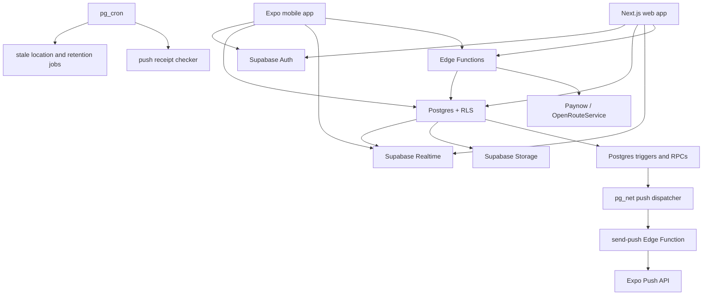

# preDrive backend architecture

## Deployment target

- Supabase project ref: `rjsdhgbjvghjnuiilizm`
- Project URL: `https://rjsdhgbjvghjnuiilizm.supabase.co`
- Region: `eu-west-1`
- PostgreSQL: 17
- Mobile client: Expo / React Native
- Web client: Next.js
- Backend: Supabase Postgres, Auth, Realtime, Storage, Edge Functions, Vault, pg_cron and pg_net

Supabase is the sole application backend. Firebase Auth and a separate Render API are not part of the architecture. Expo Push API is used for delivery; Firebase credentials are only needed if configuring the Android push credential used by Expo.

## Request and data flow

## Tenant and identity model

- A school is the tenant boundary.
- `profiles.id` is the corresponding `auth.users.id`.
- Every school-owned record carries `school_id` directly or reaches it through a parent record such as a route, invoice or thread.
- Roles are `parent`, `supervisor`, `school_admin` and `platform_owner`.
- Parents are attached to a school through a trusted invitation or `join_school_with_code`; user-editable Auth metadata cannot assign a school or staff role.
- School administrators operate only in their active school. Platform owners have cross-school read access and platform-level control, not general tenant write access.

## Trip and location flow

1. A school administrator configures a bus, route, stops and route-child manifest.
2. A supervisor starts an assigned trip through the guarded trip RPC.
3. Location updates write to `bus_live`; the database records location history and evaluates each child's configured home radius.
4. Guardian notifications are generated for proximity, arrival, trip events, delay and SOS.
5. Stale active-bus locations generate school-administrator alerts.
6. Trip completion is refused while manifest children are unaccounted for; the escalation worker repeats critical alerts until acknowledged.
7. Historical location retention is limited to 90 days. Parents can read eligible live location, never `location_history`.

## Payments

- Manual payments use `record_manual_payment`, which checks school-admin scope, invoice balance and provider reference, then writes an audit record.
- Paynow checkout is initiated by `paynow-initiate`.
- The unauthenticated callback endpoint validates Paynow's SHA-512 signature and calls the service-role-only `apply_paynow_callback` RPC.
- Payment and invoice reconciliation is atomic and idempotent. Client roles cannot insert, update or delete payment rows directly.
- Paynow remains unavailable until integration credentials are configured as Edge Function secrets.

## Edge Functions

| Function | JWT verification | Purpose |
|---|---:|---|
| `send-push` | Off; verifies webhook secret | Deliver notification through Expo Push API |
| `check-push-receipts` | Off; verifies webhook secret | Process Expo delivery receipts |
| `invite-staff` | Off; validates bearer token itself | Invite supervisor or school admin |
| `invite-parent` | Off; validates bearer token itself | Invite a parent |
| `admin-invite-user` | Off; validates bearer token itself | Unified parent/staff invitation entry point |
| `build-route-geometry` | Off; validates bearer token itself | OpenRouteService road geometry |
| `export-my-data` | On | Export guardian or school-admin data |
| `delete-my-account` | On | Revoke sessions and anonymize/delete eligible account data |
| `paynow-initiate` | On | Initiate Paynow checkout/mobile-money payment |
| `paynow-callback` | Off; validates Paynow hash | Reconcile provider callback |

All 10 functions are deployed and active in the target project. Deployment does not mean third-party integrations are configured; see [runbook](runbook.md).

## Storage

Private buckets:
- `avatars`
- `school-logos`

Storage object policies enforce school/owner scope. Do not make child or school assets public by default.

## Realtime

The publication includes:
- `notifications`
- `trip_events`
- `bus_live`
- `trips`
- `messages`
- `absences`

Realtime subscriptions must still be filtered by authenticated user and tenant; RLS remains authoritative.
